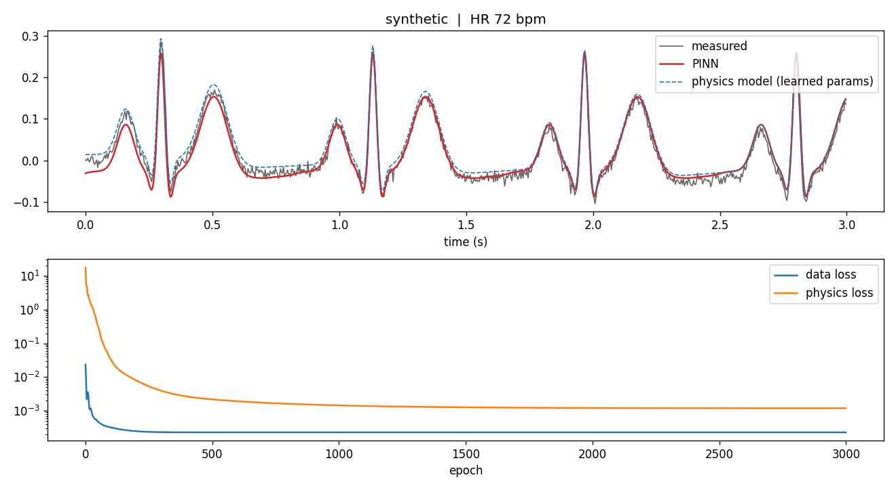

# MIMIC-ECG PINN — Physics-Informed Neural Network for ECG

MIMIC-IV-ECG 12-lead ECG에 **물리 기반 신경망(PINN, Physics-Informed Neural Network)** 을 적용해서,
심장 전기활동의 동역학 모델(McSharry ECG model)을 만족하면서 ECG를 재구성하고
**P, Q, R, S, T 파형의 생리학적 파라미터(크기·폭·위치)를 역추정**하는 프로젝트입니다.

> A physics-informed neural network that fits MIMIC-IV-ECG signals while obeying the McSharry
> cardiac dynamical model, and recovers interpretable P/Q/R/S/T wave parameters (inverse problem).



## 아이디어

| 구성 | 내용 |
|---|---|
| 입력 | 시간 `t` (ECG 한 리드, 3초 구간) |
| 출력 | ECG 전압 `z(t)` |
| 물리 법칙 | `dz/dt = -Σ a_i·Δθ_i·ω·exp(-Δθ_i² / 2b_i²) − (z − z0)` (McSharry et al., 2003) |
| 손실 | 데이터 손실(MSE) + λ × 물리 손실(ODE 잔차, autograd로 미분) |
| 학습 대상 | 신경망 가중치 + 물리 파라미터 `a_i, b_i, θ_i, z0` |
| 결과물 | 재구성 그래프 + 파형별 파라미터 JSON (해석 가능한 생리 지표) |

## 폴더 구조

```
mimic-ecg-pinn/
├── src/
│   ├── physics.py          # McSharry 심장 동역학 모델 (ODE, 시뮬레이션)
│   ├── pinn.py             # PINN 모델 + 학습 루프
│   ├── download_sample.py  # MIMIC-IV-ECG 샘플 레코드 다운로드
│   └── train.py            # 실행 스크립트 (합성 / 실제 데이터)
├── docs/                   # README용 그림
├── data/                   # (git 제외) 다운로드한 ECG
└── outputs/                # (git 제외) 학습 결과
```

## 실행 방법

```bash
python3 -m venv .venv && source .venv/bin/activate
pip install -r requirements.txt

# 1) 합성 데이터로 검증 (정답 파라미터를 알고 있음)
python src/train.py --synthetic

# 2) MIMIC-IV-ECG 샘플 다운로드 (Open Access, 계정 불필요)
python src/download_sample.py --n 3

# 3) 실제 ECG로 학습
python src/train.py --record data/mimic-iv-ecg/p1000/p10000032/s40689238/40689238 --lead II
```

CPU(M1/M2 Mac)에서 3,000 epoch 약 20–30초.

## 합성 데이터 검증 결과 (파형 크기 a_i)

| 파형 | 정답 | PINN 추정 |
|---|---|---|
| P | 1.80 | 1.85 |
| Q | -5.00 | -4.84 |
| R | 30.00 | 29.70 |
| S | -6.00 | -7.49 |
| T | 1.20 | 1.19 |

S파는 Q·R파와 시간적으로 겹쳐 파라미터 식별성(identifiability)이 낮습니다 — 향후 개선 과제.

## 데이터

- **MIMIC-IV-ECG v1.0** (PhysioNet, Open Data Commons Open Database License v1.0)
  Gow B, et al. *MIMIC-IV-ECG: Diagnostic Electrocardiogram Matched Subset.* PhysioNet.
  https://physionet.org/content/mimic-iv-ecg/1.0/
- 데이터 파일은 이 저장소에 포함하지 않습니다. `download_sample.py`로 직접 받으세요.

## 참고문헌

- McSharry PE, Clifford GD, Tarassenko L, Smith LA. A dynamical model for generating synthetic
  electrocardiogram signals. *IEEE Trans Biomed Eng.* 2003;50(3):289–294.
- Raissi M, Perdikaris P, Karniadakis GE. Physics-informed neural networks. *J Comput Phys.* 2019;378:686–707.

## 향후 계획 (TODO)

- [ ] 여러 박동(beat-by-beat) 파라미터 추정 → 시간에 따른 변화 추적
- [ ] 12-lead 동시 학습 (3D 심장 벡터 모델)
- [ ] 추정 파라미터를 특징으로 부정맥/진단 분류 (MIMIC-IV machine_measurements 연계)
- [ ] 심장 전기생리 PDE(Aliev–Panfilov) 기반 PINN으로 확장
