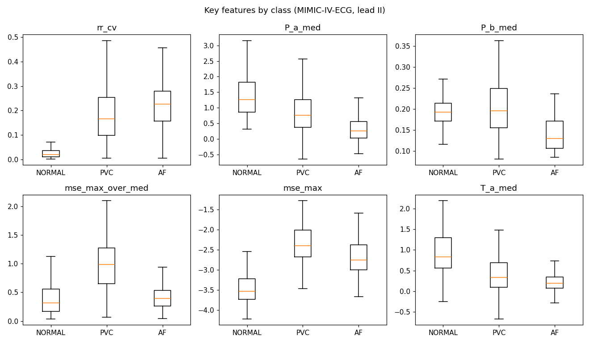

# MIMIC-ECG PINN — Physics-Informed Neural Network for ECG

[English](README.md) | **한국어**

MIMIC-IV-ECG 12-lead ECG에 **물리 기반 신경망(PINN, Physics-Informed Neural Network)** 을 적용해서,
심장 전기활동의 동역학 모델(McSharry ECG model)을 만족하면서 ECG를 재구성하고
**P, Q, R, S, T 파형의 생리학적 파라미터(크기·폭·위치)를 역추정**하는 프로젝트입니다.


## 아이디어

| 구성 | 내용 |
|---|---|
| 입력 | 시간 `t` (ECG 한 리드, 3초 구간) |
| 출력 | ECG 전압 `z(t)` |
| 물리 법칙 | `dz/dt = -Σ a_i·Δθ_i·ω·exp(-Δθ_i² / 2b_i²) − (z − z0)` (McSharry et al., 2003) |
| 손실 | 데이터 손실(MSE) + λ × 물리 손실(ODE 잔차, autograd로 미분) |
| 학습 대상 | 신경망 가중치 + 물리 파라미터 `a_i, b_i, θ_i, z0` |
| 결과물 | 재구성 그래프 + 파형별 파라미터 JSON (해석 가능한 생리 지표) |

## 폴더 구조

```
mimic-ecg-pinn/
├── src/
│   ├── physics.py          # McSharry 심장 동역학 모델 (ODE, 시뮬레이션)
│   ├── pinn.py             # PINN 모델 (단일 구간 / 박동별) + 학습 루프
│   ├── download_sample.py  # MIMIC-IV-ECG 샘플 레코드 다운로드
│   ├── train.py            # 단일 구간 학습 (합성 / 실제 데이터)
│   ├── extract_beats.py    # 여러 레코드의 박동별 파라미터 추출
│   ├── select_records.py   # MIMIC 기계 판독으로 정상 / PVC / 심방세동 레코드 선택
│   ├── classify.py         # 박동 파라미터로 정상 / PVC / 심방세동 분류
│   ├── gauss_fit.py        # 비교 기준: 박동별 가우시안 5개 커브 피팅 (신경망·미분방정식 없음)
│   └── compare_methods.py  # PINN 대 가우시안 피팅 특징 비교 (같은 분류기·교차검증)
├── docs/                   # README용 그림
├── data/                   # (git 제외) 다운로드한 ECG
└── outputs/                # (git 제외) 학습 결과
```

## 실행 방법

```bash
python3 -m venv .venv && source .venv/bin/activate
pip install -r requirements.txt

# 1) 합성 데이터로 검증 (정답 파라미터를 알고 있음)
python src/train.py --synthetic

# 2) MIMIC-IV-ECG 샘플 다운로드 (Open Access, 계정 불필요)
python src/download_sample.py --n 3

# 3) 실제 ECG로 학습
python src/train.py --record data/mimic-iv-ecg/p1000/p10000032/s40689238/40689238 --lead II

# 4) 받은 모든 레코드의 박동별 파라미터 추출
python src/download_sample.py --n 20
python src/extract_beats.py --lead II

# 5) 분류: 정상 / PVC / 심방세동 (PhysioNet의 machine_measurements.csv, 183 MB 필요)
python src/select_records.py --per-class 100 --download
python src/extract_beats.py --data data/cls --out outputs/cls --shard 0/3 --threads 3   # 1/3, 2/3도 동시에 실행
python src/classify.py
python src/gauss_fit.py && python src/compare_methods.py
```

CPU(M1/M2 Mac)에서 3,000 epoch 약 20–30초.

## 박동별 파라미터 추출

`extract_beats.py`는 **10초 레코드마다 PINN을 하나** 학습하지만, **물리 파라미터(P~T의 a, b, θ)는
박동마다 따로** 추정합니다. 위상은 검출된 R-peak 사이에서 직선으로 증가하므로 박동 간 심박수 변화도 반영됩니다.

| 출력 | 내용 |
|---|---|
| `outputs/beat_params.csv` | 박동 1개당 1줄: `record, subject_id, lead, beat, r_time_s, rr_s, hr_bpm, beat_mse, P_a, P_b, P_theta, …, T_theta, z0, scale, record_data_loss, record_physics_loss` |
| `outputs/skipped_records.csv` | 처리하지 못한 레코드와 이유 (예: R-peak 부족) |
| `outputs/beat_figs/<record>.png` | 측정 vs PINN 재구성 그래프 (R-peak 표시) |

**첫 실행 결과 (환자 7명의 레코드 20개, 리드 II, 3,000 epoch):** 박동 271개 추출, 건너뛴 레코드 0개,
CPU에서 레코드당 약 40초. 심박수는 47–199 bpm(평균 88). 한 레코드 안에서 T파 크기는 박동마다
중앙값 16%(변동계수) 정도 달라졌습니다.

**관찰:** 재구성 오차(`beat_mse`)가 가장 큰 박동은 **조기 박동(이소성 박동)** 이었습니다. 일찍 나타나는 넓은 QRS와
그 뒤의 휴지기가 특징입니다. McSharry 모델은 정상 P-QRS-T 모양을 가정하므로 이런 박동을 잘 맞추지 못합니다.
모델 적합 잔차로 조기 박동을 찾는 방법은 이미 알려져 있으며(예: 칼만필터 파형 모델을 쓴 Sayadi 등, 2010),
PINN에서도 같은 현상이 나타난 것입니다.

## 분류: 정상 / PVC / 심방세동

**설정.** MIMIC-IV-ECG 기계 판독문으로 라벨을 정했습니다(`select_records.py`). 정상(동리듬, "normal ECG",
이상 소견 없음), PVC(동리듬 + 심실 조기 수축), 심방세동이며, 심방조동·페이싱·각차단은 제외했습니다.
클래스당 100개, 환자당 검사 1개입니다. R-peak를 검출하지 못한 12개(심방세동 7, 정상 3, PVC 2)를 빼고
**288개 레코드**(정상 97, PVC 98, 심방세동 93, 리드 II, 박동 4,014개)를 썼습니다.

레코드마다 리듬 특징(RR 평균·표준편차·변동계수·RMSSD)과 박동 파라미터의 중앙값·표준편차, 적합 오차 요약을
계산했습니다. 평가는 5겹 층화 교차검증 5회 반복, 매크로 one-vs-rest AUC입니다.

| 특징 | 랜덤포레스트 | 로지스틱 회귀 |
|---|---|---|
| RR만 (기준) | 0.845 | 0.868 |
| 가우시안 피팅 파라미터만 | 0.902 | 0.872 |
| PINN 파라미터만 | 0.925 | 0.908 |
| RR + 가우시안 피팅 | 0.918 | 0.893 |
| **RR + PINN** | **0.936** | **0.914** |
| RR + PINN + 가우시안 피팅 | 0.946 | 0.910 |

클래스별 AUC(랜덤포레스트, RR + PINN): 정상 0.981, PVC 0.897, 심방세동 0.930.
RR만 쓰면 PVC와 심방세동 구분이 어려웠습니다(0.755, 0.811). 둘 다 RR이 불규칙하기 때문입니다.

**파라미터가 생리학적 예상과 일치합니다.** P파 크기 `P_a` 중앙값은 정상 1.26, PVC 0.76, 심방세동 0.25였습니다
(심방세동은 정상적인 P파가 없음). 가장 안 맞는 박동의 오차를 보통 박동 오차로 나눈 값(`mse_max_over_med`, log10)은
정상 0.31, 심방세동 0.39, PVC 0.98이었습니다(일부 박동만 모양이 다름).



**PINN 대 일반 커브 피팅.** 핵심 질문은 PINN이 기존 방식인 박동별 가우시안 5개 피팅(Clifford 등, 2005)보다
나은가입니다. 두 방법을 같은 박동, 같은 특징·분류기·교차검증으로 비교했습니다. 실행 **전에** 기준을 정했습니다:
RR + PINN이 RR + 가우시안보다 AUC가 +0.02 이상 높아야(랜덤포레스트) PINN이 낫다고 판단합니다.

- 결과: 0.936 대 0.918 = **+0.018로 기준 미달.** 교차검증 5회 모두 PINN이 앞섰고(+0.008 ~ +0.026),
  모양 파라미터만 쓰면 +0.023 ~ +0.036 차이였습니다. 차이가 가장 큰 클래스는 PVC였습니다.
- 가우시안 피팅이 박동을 더 정확히 맞췄지만(박동 오차 중앙값 1.0e-4 대 PINN 4.1e-4), 분류는 조금 못했습니다.
- PINN의 물리 손실 값 자체는 도움이 되지 않았습니다(빼도 0.935).
- 계산량: 가우시안 피팅 전체 약 7분, PINN 약 70분 × 병렬 3개(CPU 약 30배).

**결론:** PINN 박동 파라미터는 일반 커브 피팅보다 작지만 일관된 이점이 있으나, 미리 정한 기준에는 미치지 못했습니다.

**한계**
- 라벨은 전문의 판독이 아닌 기계 판독이며, 기계 알고리즘도 리듬과 모양을 보기 때문에 순환 논리가 있을 수 있습니다.
- 리듬 기준선이 단순합니다(RR 통계 4개). 표준 간격 측정값(PR, QRS, QT)은 기준선에 넣지 않았습니다.
- 단일 리드(II), 288개 레코드, 데이터셋 1개입니다. 교차검증 반복은 독립 표본이 아니어서 유의성 검정은 하지 않았습니다.

## 합성 데이터 검증 결과 (파형 크기 a_i)

| 파형 | 정답 | PINN 추정 |
|---|---|---|
| P | 1.80 | 1.85 |
| Q | -5.00 | -4.84 |
| R | 30.00 | 29.70 |
| S | -6.00 | -7.49 |
| T | 1.20 | 1.19 |

S파는 Q·R파와 시간적으로 겹쳐 파라미터 식별성(identifiability)이 낮습니다 — 향후 개선 과제.

## 데이터

- **MIMIC-IV-ECG v1.0** (PhysioNet, Open Data Commons Open Database License v1.0)
  Gow B, et al. *MIMIC-IV-ECG: Diagnostic Electrocardiogram Matched Subset.* PhysioNet.
  https://physionet.org/content/mimic-iv-ecg/1.0/
- 데이터 파일은 이 저장소에 포함하지 않습니다. `download_sample.py`로 직접 받으세요.

## 참고문헌

- McSharry PE, Clifford GD, Tarassenko L, Smith LA. A dynamical model for generating synthetic
  electrocardiogram signals. *IEEE Trans Biomed Eng.* 2003;50(3):289–294.
- Raissi M, Perdikaris P, Karniadakis GE. Physics-informed neural networks. *J Comput Phys.* 2019;378:686–707.
- Clifford GD, Shoeb A, McSharry PE, Janz BA. Model-based filtering, compression and classification of the ECG.
  *Int J Bioelectromagnetism.* 2005;7(1):158–161.
- Sayadi O, Shamsollahi MB, Clifford GD. Robust detection of premature ventricular contractions using a
  wave-based Bayesian framework. *IEEE Trans Biomed Eng.* 2010;57(2):353–362.

## 향후 계획 (TODO)

- [x] 여러 박동(beat-by-beat) 파라미터 추정 → 시간에 따른 변화 추적
- [ ] 12-lead 동시 학습 (3D 심장 벡터 모델)
- [x] 추정 파라미터를 특징으로 부정맥/진단 분류 (MIMIC-IV machine_measurements 연계)
- [ ] 표준 간격 측정값(PR, QRS, QT) 및 전문의 판독 데이터와 비교
- [ ] 심장 전기생리 PDE(Aliev–Panfilov) 기반 PINN으로 확장

## 라이선스

코드: [MIT](LICENSE). MIMIC-IV-ECG 데이터는 포함되지 않으며 자체 라이선스(ODbL v1.0)를 따릅니다.
