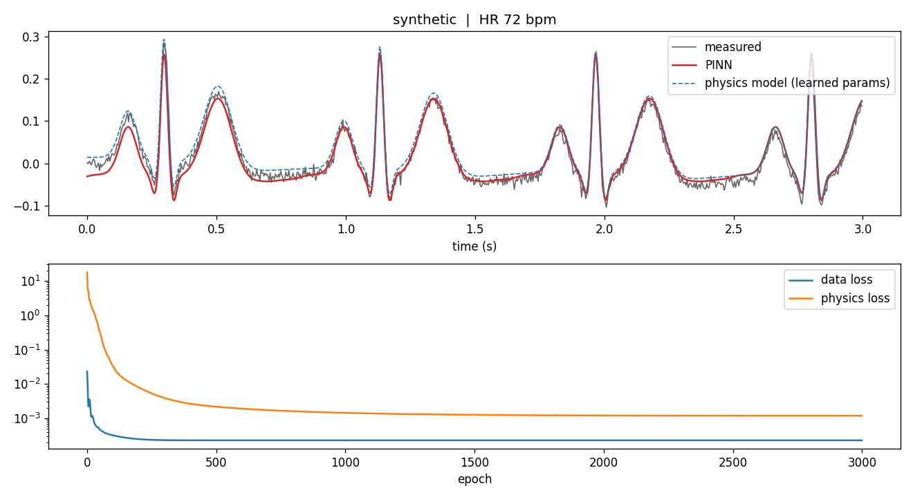

# MIMIC-ECG PINN — Physics-Informed Neural Network for ECG

**English** | [한국어](README.ko.md)

This project applies a **Physics-Informed Neural Network (PINN)** to 12-lead ECGs from MIMIC-IV-ECG.
The network reconstructs the ECG while obeying a cardiac dynamical model (the McSharry ECG model).
In doing so, it **recovers interpretable physiological parameters** (amplitude, width and timing) for the
P, Q, R, S and T waves, which makes this an inverse problem.



## Approach

| Component | Description |
|---|---|
| Input | Time `t` (one ECG lead, 3-second window) |
| Output | ECG voltage `z(t)` |
| Physics | `dz/dt = -Σ a_i·Δθ_i·ω·exp(-Δθ_i² / 2b_i²) − (z − z0)` (McSharry et al., 2003) |
| Loss | Data loss (MSE) + λ × physics loss (ODE residual, derivatives via autograd) |
| Trainable | Network weights + physical parameters `a_i, b_i, θ_i, z0` |
| Results | Reconstruction plot + per-wave parameter JSON (interpretable physiological markers) |

Here `θ_i` is the phase position of each wave (R = 0), `a_i` its amplitude, `b_i` its width,
and `ω = 2π / RR` the angular frequency estimated from detected R-peaks.

## Repository structure

```
mimic-ecg-pinn/
├── src/
│   ├── physics.py          # McSharry cardiac dynamical model (ODE, simulation)
│   ├── pinn.py             # PINN models (single window / beat-by-beat) + training loop
│   ├── download_sample.py  # Download sample records from MIMIC-IV-ECG
│   ├── train.py            # Single-window fit (synthetic / real data)
│   └── extract_beats.py    # Beat-by-beat parameter extraction over many records
├── docs/                   # Figures for the README
├── data/                   # (git-ignored) downloaded ECGs
└── outputs/                # (git-ignored) training results
```

## Quick start

```bash
python3 -m venv .venv && source .venv/bin/activate
pip install -r requirements.txt

# 1) Validate on synthetic data (ground-truth parameters are known)
python src/train.py --synthetic

# 2) Download MIMIC-IV-ECG samples (Open Access, no account required)
python src/download_sample.py --n 3

# 3) Train on a real ECG
python src/train.py --record data/mimic-iv-ecg/p1000/p10000032/s40689238/40689238 --lead II

# 4) Beat-by-beat parameters for every downloaded record
python src/download_sample.py --n 20
python src/extract_beats.py --lead II
```

3,000 epochs take about 20–30 seconds on CPU (Apple M1/M2).

## Beat-by-beat extraction

`extract_beats.py` trains **one PINN per 10-second record** but gives **each beat its own physical
parameters** (a, b, θ for P, Q, R, S, T). The phase runs linearly from one detected R-peak to the next,
so heart-rate changes between beats are handled.

| Output | Content |
|---|---|
| `outputs/beat_params.csv` | One row per beat: `record, subject_id, lead, beat, r_time_s, rr_s, hr_bpm, beat_mse, P_a, P_b, P_theta, …, T_theta, z0, scale, record_data_loss, record_physics_loss` |
| `outputs/skipped_records.csv` | Records that could not be processed, with the reason (e.g. too few R-peaks) |
| `outputs/beat_figs/<record>.png` | Measured vs PINN reconstruction with R-peaks marked |

**First run (20 records from 7 subjects, lead II, 3,000 epochs):** 271 beats extracted, 0 records skipped,
about 40 s per record on CPU. Heart rate ranged 47–199 bpm (mean 88). The amplitude of the T wave varied
by a median of 16% (coefficient of variation) from beat to beat within a record.

**Observation:** the beats with the largest reconstruction error (`beat_mse`) were **premature (ectopic)
beats**: early, wide QRS complexes followed by a pause. The McSharry model describes a normal P-QRS-T
shape, so it does not fit these beats well. This suggests `beat_mse` could be used to flag abnormal beats,
which is worth testing in the classification step.

## Synthetic validation (wave amplitudes a_i)

| Wave | Ground truth | PINN estimate |
|---|---|---|
| P | 1.80 | 1.85 |
| Q | -5.00 | -4.84 |
| R | 30.00 | 29.70 |
| S | -6.00 | -7.49 |
| T | 1.20 | 1.19 |

The S wave overlaps in time with the Q and R waves. This makes its parameters harder to identify
(low identifiability) and is a target for future work.

## Data

- **MIMIC-IV-ECG v1.0** (PhysioNet, Open Data Commons Open Database License v1.0)
  Gow B, et al. *MIMIC-IV-ECG: Diagnostic Electrocardiogram Matched Subset.* PhysioNet.
  https://physionet.org/content/mimic-iv-ecg/1.0/
- No data files are included in this repository. Download them with `download_sample.py`.

## References

- McSharry PE, Clifford GD, Tarassenko L, Smith LA. A dynamical model for generating synthetic
  electrocardiogram signals. *IEEE Trans Biomed Eng.* 2003;50(3):289–294.
- Raissi M, Perdikaris P, Karniadakis GE. Physics-informed neural networks. *J Comput Phys.* 2019;378:686–707.

## Roadmap

- [x] Beat-by-beat parameter estimation, to track how parameters change over time
- [ ] Joint training on all 12 leads (3D cardiac vector model)
- [ ] Diagnostic / arrhythmia classification using the estimated parameters as features (linked to MIMIC-IV machine_measurements)
- [ ] Extension to a PINN based on a cardiac electrophysiology PDE (Aliev–Panfilov)

## License

Code: [MIT](LICENSE). The MIMIC-IV-ECG data is not included and is governed by its own license (ODbL v1.0).
